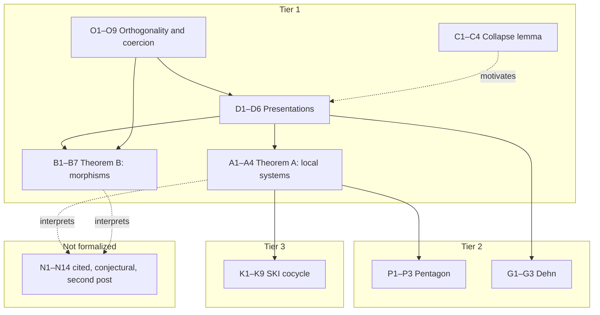

# Proof map

Every definition, lemma, theorem and conjecture, with a typed statement,
dependencies, tier and status.

**The Lean in this file is pseudo-Lean. None of it has been compiled.**
Mathlib names are best guesses. Universe levels are mostly omitted and will
need care. Treat each signature as a statement of intent.

## Conventions

Each node has a header line in this exact shape, which the check script reads:

    #### ID — name
    kind: def|lemma|theorem|example|conjecture|cited · tier: 1|2|3|stretch|none · status: HAND|CITED|MEMORY|CONJ|SPEC · deps: ID, ID, …

- **kind** `cited` means a published result we rely on and do not formalize.
- **tier** `none` means not to be formalized for the first post.
- **deps** lists only nodes in this file. Mathlib dependencies are listed at
  the end.
- Composition is by dependency only: a node may use exactly the nodes in its
  `deps` line (and Mathlib).

## Overview



| Module | Nodes | Post section |
|---|---|---|
| `Orth` | O1–O9 | Coercion; definition |
| `Presentation` | D1–D6 | The definition |
| `LocalSystems` | A1–A4 | Theorem A |
| `Translation` | B1–B7 | Theorem B |
| `Collapse` | C1–C4 | Why a factorization system |
| `Pentagon` | P1–P3 | Associativity |
| `Dehn` | G1–G3 | Groups |
| `SKI.*` | K1–K9 | SKI |

---

## Tier 1 — `Orth`: unique lifting and coercion

#### O1 — Orth
kind: def · tier: 1 · status: HAND · deps:

```lean
variable {C : Type u} [Category.{v} C]

/-- `e` is left orthogonal to `p`: every commuting square has a unique diagonal. -/
def Orth {A B X Y : C} (e : A ⟶ B) (p : X ⟶ Y) : Prop :=
  ∀ (u : A ⟶ X) (w : B ⟶ Y), u ≫ p = e ≫ w →
    ∃! d : B ⟶ X, e ≫ d = u ∧ d ≫ p = w
```

#### O2 — rOrth, lOrth
kind: def · tier: 1 · status: HAND · deps: O1

```lean
def rOrth (S : MorphismProperty C) : MorphismProperty C :=
  fun _ _ p => ∀ ⦃A B : C⦄ (e : A ⟶ B), S e → Orth e p

def lOrth (T : MorphismProperty C) : MorphismProperty C :=
  fun _ _ e => ∀ ⦃X Y : C⦄ (p : X ⟶ Y), T p → Orth e p
```

#### O3 — Galois connection
kind: lemma · tier: 1 · status: HAND · deps: O2

```lean
theorem le_lOrth_iff_le_rOrth (S T : MorphismProperty C) :
    S ≤ lOrth T ↔ T ≤ rOrth S
```

#### O4 — closure of the right class
kind: lemma · tier: 1 · status: HAND · deps: O2

```lean
theorem rOrth_of_isIso (S : MorphismProperty C) {X Y : C} (p : X ⟶ Y) [IsIso p] :
    rOrth S p
theorem rOrth_comp (S) {X Y Z : C} (p : X ⟶ Y) (q : Y ⟶ Z) :
    rOrth S p → rOrth S q → rOrth S (p ≫ q)
/-- stable under base change (substitution) -/
theorem rOrth_of_isPullback (S) {W X Y Z : C} {fst : W ⟶ X} {snd : W ⟶ Y}
    {f : X ⟶ Z} {g : Y ⟶ Z} (sq : IsPullback fst snd f g) :
    rOrth S g → rOrth S fst
/-- left cancellation -/
theorem rOrth_cancel (S) {X Y Z : C} (p : X ⟶ Y) (q : Y ⟶ Z) :
    rOrth S (p ≫ q) → rOrth S q → rOrth S p
```

#### O5 — diagonal
kind: lemma · tier: 1 · status: HAND · deps: O4

```lean
theorem rOrth_diagonal [HasPullbacks C] (S) {X Y : C} (p : X ⟶ Y) :
    rOrth S p → rOrth S (pullback.diagonal p)
```

#### O6 — adjunctions transpose orthogonality
kind: lemma · tier: 1 · status: HAND · deps: O1

```lean
theorem orth_adj {D : Type*} [Category D] {G : C ⥤ D} {R : D ⥤ C} (adj : G ⊣ R)
    {A B : C} (e : A ⟶ B) {X Y : D} (q : X ⟶ Y) :
    Orth (G.map e) q ↔ Orth e (R.map q)
```

Used for function types (Frobenius) and for B5.

#### O7 — sections and restriction
kind: lemma · tier: 1 · status: HAND · deps: O1

```lean
/-- the fibre of `p` over a generalized point `x` -/
def Sec {X Y : C} (p : X ⟶ Y) {T : C} (x : T ⟶ Y) : Type v :=
  { d : T ⟶ X // d ≫ p = x }

def restrict {X Y : C} (p : X ⟶ Y) {T T' : C} (e : T ⟶ T') (x : T' ⟶ Y) :
    Sec p x → Sec p (e ≫ x) :=
  fun d => ⟨e ≫ d.1, by simp [d.2]⟩

/-- coercion inverts restriction -/
theorem orth_iff_restrict_bijective {X Y T T' : C} (e : T ⟶ T') (p : X ⟶ Y) :
    Orth e p ↔ ∀ x : T' ⟶ Y, Function.Bijective (restrict p e x)
```

#### O8 — coercion and its functoriality
kind: def · tier: 1 · status: HAND · deps: O7

```lean
noncomputable def coe {X Y T T' : C} {e : T ⟶ T'} {p : X ⟶ Y} (h : Orth e p)
    (x : T' ⟶ Y) : Sec p (e ≫ x) → Sec p x

theorem coe_restrict (h : Orth e p) (x) (d : Sec p x) : coe h x (restrict p e x d) = d
theorem coe_id   -- coercion along `𝟙` is the identity, up to the evident cast
theorem coe_comp -- coercion along `e ≫ e'` is the composite, up to the evident cast
```

The casts come from `(e ≫ e') ≫ x = e ≫ (e' ≫ x)`. Consider stating
functoriality for `restrict` and deriving it for `coe`.

#### O9 — local objects
kind: lemma · tier: 1 · status: HAND · deps: O2

```lean
theorem rOrth_terminal_iff_isLocal [HasTerminal C] (S : MorphismProperty C) (X : C) :
    rOrth S (terminal.from X) ↔ S.isLocal X
```

---

## Tier 1 — `Presentation`

#### D1 — Presentation
kind: def · tier: 1 · status: HAND · deps:

```lean
structure Presentation (P : Type u) [Category.{v} P] where
  steps : MorphismProperty P
```

#### D2 — M, E, behaviours, conversions
kind: def · tier: 1 · status: HAND · deps: D1, O2

```lean
namespace Presentation
variable {P : Type u} [Category.{v} P] (𝒫 : Presentation P)

def M    : MorphismProperty P := rOrth 𝒫.steps
def E    : MorphismProperty P := lOrth 𝒫.M
def Beh  : ObjectProperty P   := 𝒫.steps.isLocal
/-- maps that every behaviour sees as an isomorphism -/
def Conv : MorphismProperty P := 𝒫.Beh.isLocal
```

#### D3 — basic inclusions
kind: lemma · tier: 1 · status: HAND · deps: D2, O3, O9

```lean
theorem steps_le_E : 𝒫.steps ≤ 𝒫.E
theorem E_le_Conv [HasTerminal P] : 𝒫.E ≤ 𝒫.Conv
theorem beh_iff_M [HasTerminal P] (X : P) : 𝒫.Beh X ↔ 𝒫.M (terminal.from X)
instance : 𝒫.Conv.HasTwoOutOfThreeProperty
```

#### D4 — convergence and evaluation
kind: def · tier: 1 · status: HAND · deps: D2

```lean
/-- the size condition: `(E, M)` factors every map -/
class Convergent : Prop where
  fac : 𝒫.E.HasFactorization 𝒫.M

/-- when behaviours are reflective, `L` is the reflector and `η` its unit -/
variable [Reflective 𝒫.Beh.ι]
noncomputable def L : P ⥤ 𝒫.Beh.FullSubcategory := reflector 𝒫.Beh.ι
theorem conv_iff_isIso_L {X Y : P} (f : X ⟶ Y) : 𝒫.Conv f ↔ IsIso (𝒫.L.map f)
theorem unit_mem_Conv (X : P) : 𝒫.Conv ((reflectorAdjunction 𝒫.Beh.ι).unit.app X)
```

`conv_iff_isIso_L` should be close to a Mathlib lemma in
`Localization/Bousfield`. Whether `Convergent` implies `Reflective` (with a
terminal object) is a good first lemma: factor `X ⟶ ⊤`.

#### D5 — the dynamic picture
kind: def · tier: 1 · status: HAND · deps: D1

```lean
structure DynPresentation (A : Type u) [Category.{v} A] where
  steps : MorphismProperty A

/-- type families over terms are covariant -/
def DynPresentation.toPresentation {A} [Category.{v} A] (𝒜 : DynPresentation A) :
    Presentation (A ⥤ Type v) where
  steps := fun _ _ τ =>
    ∃ (t t' : A) (s : t ⟶ t'), 𝒜.steps s ∧
      Nonempty (Arrow.mk τ ≅ Arrow.mk (coyoneda.map s.op))
```

#### D6 — traces
kind: def · tier: stretch · status: HAND · deps: D2

```lean
/-- cell decompositions: built from pushouts of steps and composition -/
inductive Trace (𝒫 : Presentation P) : ∀ {X Y : P}, (X ⟶ Y) → Type _
  | id (X) : Trace 𝒫 (𝟙 X)
  | cell {A B X Y} (s : A ⟶ B) (hs : 𝒫.steps s) (a : A ⟶ X) (b : B ⟶ Y) (f : X ⟶ Y)
      (sq : IsPushout s a b f) : Trace 𝒫 f
  | comp {X Y Z} {f : X ⟶ Y} {g : Y ⟶ Z} : Trace 𝒫 f → Trace 𝒫 g → Trace 𝒫 (f ≫ g)

def Trace.length : Trace 𝒫 f → ℕ
theorem Trace.mem_E (t : Trace 𝒫 f) : 𝒫.E f
```

---

## Tier 1 — `LocalSystems`: Theorem A

#### A1 — local means steps act bijectively
kind: lemma · tier: 1 · status: HAND · deps: D5, D2

```lean
theorem beh_iff_map_bijective {A} [Category.{v} A] (𝒜 : DynPresentation A)
    (B : A ⥤ Type v) :
    𝒜.toPresentation.Beh B ↔
      ∀ ⦃t t' : A⦄ (s : t ⟶ t'), 𝒜.steps s → Function.Bijective (B.map s)
```

Proof: Yoneda.

#### A2 — behaviours are functors inverting the steps
kind: theorem · tier: 1 · status: HAND · deps: A1

```lean
noncomputable def behEquivInverting (𝒜 : DynPresentation A) :
    𝒜.toPresentation.Beh.FullSubcategory ≌ 𝒜.steps.FunctorsInverting (Type v)
```

#### A3 — Theorem A: behaviours are local systems
kind: theorem · tier: 1 · status: HAND · deps: A2

```lean
noncomputable def behEquivLocalSystems (𝒜 : DynPresentation A) :
    𝒜.toPresentation.Beh.FullSubcategory ≌ (𝒜.steps.Localization ⥤ Type v)
```

Uses the universal property of localization (Mathlib:
`Localization.functorEquivalence` or `whiskeringLeftFunctor'`).

#### A4 — a terminal object makes the fibre contractible
kind: theorem · tier: 1 · status: HAND · deps: A3

```lean
/-- if every map is a step and `n` is terminal, the reduction groupoid is trivial -/
theorem localization_trivial_of_terminal {A} [Category A] (n : A) (hn : IsTerminal n) :
    Nonempty ((⊤ : MorphismProperty A).Localization ≌ Discrete PUnit)

/-- so behaviours are bare sets: evaluation is path-independent -/
theorem beh_equiv_type_of_terminal (𝒜 : DynPresentation A) (h : 𝒜.steps = ⊤)
    (n : A) (hn : IsTerminal n) :
    Nonempty (𝒜.toPresentation.Beh.FullSubcategory ≌ Type v)
```

This is the formal content of "coherence theorem ⇔ behaviours are a bare set
of values" in one direction, per connected component.

---

## Tier 1 — `Translation`: Theorem B

#### B1 — right adjoints preserve local objects
kind: lemma · tier: 1 · status: HAND · deps:

```lean
theorem isLocal_of_adj {P P'} [Category P] [Category P'] {G : P ⥤ P'} {R : P' ⥤ P}
    (adj : G ⊣ R) (S : MorphismProperty P) (S' : MorphismProperty P')
    (h : ∀ ⦃X Y : P⦄ (f : X ⟶ Y), S f → (S'.isLocal).isLocal (G.map f))
    (Z : P') (hZ : S'.isLocal Z) : S.isLocal (R.obj Z)
```

Only conversions are needed in the hypothesis.

#### B2 — simulations, and Theorem B
kind: theorem · tier: 1 · status: HAND · deps: B1, D2, D3, D4

```lean
structure Simulation (𝒫 : Presentation P) (𝒫' : Presentation P') where
  G : P ⥤ P'
  R : P' ⥤ P
  adj : G ⊣ R
  steps_to_E : ∀ ⦃X Y : P⦄ (f : X ⟶ Y), 𝒫.steps f → 𝒫'.E (G.map f)

/-- restriction of the right adjoint to behaviours -/
def Simulation.onBeh [HasTerminal P'] (σ : Simulation 𝒫 𝒫') :
    𝒫'.Beh.FullSubcategory ⥤ 𝒫.Beh.FullSubcategory

/-- Theorem B -/
noncomputable def Simulation.adjOnBeh [HasTerminal P'] [Reflective 𝒫'.Beh.ι]
    (σ : Simulation 𝒫 𝒫') :
    (𝒫.Beh.ι ⋙ σ.G ⋙ 𝒫'.L) ⊣ σ.onBeh
```

#### B3 — uniting rule sets intersects behaviours
kind: lemma · tier: 1 · status: HAND · deps:

```lean
theorem isLocal_sup (S₁ S₂ : MorphismProperty P) :
    (S₁ ⊔ S₂).isLocal = S₁.isLocal ⊓ S₂.isLocal
```

#### B4 — completion is harmless
kind: lemma · tier: 1 · status: HAND · deps:

```lean
theorem isLocal_eq_of_le_of_le_conv (S S' : MorphismProperty P)
    (h₁ : S ≤ S') (h₂ : S' ≤ (S.isLocal).isLocal) : S'.isLocal = S.isLocal
```

#### B5 — simulations preserve computations
kind: lemma · tier: 1 · status: HAND · deps: B2, O6

```lean
theorem Simulation.R_preserves_M (σ : Simulation 𝒫 𝒫') :
    ∀ ⦃X Y : P'⦄ (q : X ⟶ Y), 𝒫'.M q → 𝒫.M (σ.R.map q)
theorem Simulation.G_preserves_E (σ : Simulation 𝒫 𝒫') :
    ∀ ⦃X Y : P⦄ (f : X ⟶ Y), 𝒫.E f → 𝒫'.E (σ.G.map f)
```

#### B6 — composition
kind: def · tier: 1 · status: HAND · deps: B5

```lean
def Simulation.id (𝒫 : Presentation P) : Simulation 𝒫 𝒫
def Simulation.comp (σ : Simulation 𝒫 𝒫') (τ : Simulation 𝒫' 𝒫'') : Simulation 𝒫 𝒫''
```

#### B7 — translations; conjoints
kind: def · tier: stretch · status: HAND · deps: B2, D5

```lean
/-- a functor on terms whose pushforward sends steps to computations -/
structure Translation (𝒜 : DynPresentation A) (𝒜' : DynPresentation A') where
  F : A ⥤ A'
  steps_to_E : ∀ ⦃t t' : A⦄ (s : t ⟶ t'), 𝒜.steps s →
    𝒜'.toPresentation.E (coyoneda.map (F.map s).op)

noncomputable def Translation.toSimulation (τ : Translation 𝒜 𝒜') :
    Simulation 𝒜.toPresentation 𝒜'.toPresentation   -- G = left Kan extension along F

/-- `F` has a conjoint when restriction also preserves computations -/
def Translation.HasConjoint (τ : Translation 𝒜 𝒜') : Prop :=
  ∀ ⦃X Y⦄ (f : X ⟶ Y), 𝒜'.toPresentation.steps f →
    𝒜.toPresentation.E (((whiskeringLeft _ _ _).obj τ.F).map f)

/-- then restriction on behaviours also has a right adjoint: an adjoint triple -/
theorem Translation.adjointTriple_of_hasConjoint : …
```

---

## Tier 1 — `Collapse`

#### C1 — the inserter category
kind: def · tier: 1 · status: HAND · deps:

```lean
variable {Xn X : Type*} [Category Xn] [Category X] (l r : Xn ⥤ X)

structure Ins where
  a : Xn
  φ : l.obj a ⟶ r.obj a

instance : Category (Ins l r) where
  Hom p q := { u : p.a ⟶ q.a // p.φ ≫ r.map u = l.map u ≫ q.φ }
  id p := ⟨𝟙 _, by simp⟩
  comp f g := ⟨f.1 ≫ g.1, by …⟩

def Ins.forget : Ins l r ⥤ Xn
```

#### C2 — collapse, unfolded form
kind: lemma · tier: 1 · status: HAND · deps: C1

```lean
theorem collapse_unfolded (ρ : ∀ a, l.obj a ⟶ r.obj a)
    (h : ∀ ⦃a a' : Xn⦄ (u : a ⟶ a') (φ' : l.obj a' ⟶ r.obj a'),
        ρ a ≫ r.map u = l.map u ≫ φ') :
    ∀ (a : Xn) (φ : l.obj a ⟶ r.obj a), φ = ρ a
```

Proof: take `u = 𝟙 a`.

#### C3 — collapse lemma
kind: theorem · tier: 1 · status: HAND · deps: C2

```lean
/-- the section of `forget` determined by a natural family `ρ` -/
def Ins.sec (ρ : l ⟶ r) : Xn ⥤ Ins l r where
  obj a := ⟨a, ρ.app a⟩
  map u := ⟨u, (ρ.naturality u).symm⟩   -- direction to be fixed

/-- if that section is left adjoint to `forget` with identity unit,
    then `ρ` is the only arrow from each `l a` to `r a` -/
theorem collapse (ρ : l ⟶ r) (adj : Ins.sec l r ρ ⊣ Ins.forget l r)
    (hunit : ∀ a, adj.unit.app a = 𝟙 a) :
    ∀ (a : Xn) (φ : l.obj a ⟶ r.obj a), φ = ρ.app a
```

Parametrizing the section by `ρ` avoids equalities between functors. The note
(`notes/06` §6.1) states the lemma for an arbitrary left adjoint section; show
that any such section is of the form `Ins.sec ρ` if time allows.

#### C4 — the counterexample
kind: example · tier: 1 · status: HAND · deps:

```lean
/-- `I = (– × Bool)` with `ι = fst` is a copointed endofunctor on types -/
def Icop : Type ⥤ Type where
  obj a := a × Bool
  map f := Prod.map f id
def ι : Icop ⟶ 𝟭 Type where app _ := Prod.fst

/-- the two reductions `I (I a) ⇒ I a` differ -/
theorem accident : whiskerLeft Icop ι ≠ whiskerRight ι Icop
```

So this model is not lax orthogonal to the I-rule, though it is a perfectly
good model.

---

## Tier 2 — `Pentagon`

#### P1 — the pentagon quiver
kind: def · tier: 2 · status: HAND · deps:

```lean
/-- bracketings of four letters:
    a = ((xy)z)w, b = (xy)(zw), c = x(y(zw)), d = (x(yz))w, e = x((yz)w) -/
inductive V4 | a | b | c | d | e
  deriving DecidableEq, Fintype

inductive Edge : V4 → V4 → Type
  | ab : Edge .a .b | bc : Edge .b .c
  | ad : Edge .a .d | de : Edge .d .e | ec : Edge .e .c

instance : Quiver V4 := ⟨Edge⟩
abbrev PentCat := Paths V4

def top : (Paths.of.obj V4.a) ⟶ (Paths.of.obj V4.c)   -- ab ≫ bc
def bot : (Paths.of.obj V4.a) ⟶ (Paths.of.obj V4.c)   -- ad ≫ de ≫ ec
```

#### P2 — the free pentagon has a loop detected by ℤ
kind: theorem · tier: 2 · status: HAND · deps: P1, A3

```lean
/-- weight 1 on `ab`, 0 elsewhere -/
def wt : PentCat ⥤ SingleObj (Multiplicative ℤ)

theorem wt_top_ne_wt_bot : wt.map top ≠ wt.map bot

/-- hence `top` and `bot` stay distinct in the reduction groupoid -/
theorem top_ne_bot_localized :
    (⊤ : MorphismProperty PentCat).Q.map top ≠ (⊤ : MorphismProperty PentCat).Q.map bot
```

The second statement follows because `wt` lands in a groupoid and so factors
through the localization. With A3: behaviours over this component include sets
with a nontrivial automorphism.

#### P3 — imposing the pentagon gives a terminal object
kind: theorem · tier: 2 · status: HAND · deps: P1, A4

```lean
/-- the four-variable Tamari order -/
instance : PartialOrder V4   -- a ≤ b ≤ c, a ≤ d ≤ e ≤ c
instance : OrderTop V4       -- top is `c`, the right-bracketed form

/-- the quotient of `PentCat` by `top = bot` is that poset (stretch) -/
def pentQuotientEquiv : Quotient (fun _ _ f g => (f = top ∧ g = bot)) ≌ V4
```

Then A4 applies: behaviours over this component are bare sets.

---

## Tier 2 — `Dehn`

#### G1 — relator deletion
kind: def · tier: 2 · status: HAND · deps:

```lean
variable {X : Type*} (R : Set (FreeGroup X))

def Rsym : Set (FreeGroup X) := R ∪ {r | r⁻¹ ∈ R}

inductive DStep : FreeGroup X → FreeGroup X → Prop
  | del (u r v : FreeGroup X) (hr : r ∈ Rsym R) : DStep (u * r * v) (u * v)

inductive DChain : ℕ → FreeGroup X → FreeGroup X → Prop
  | nil (g) : DChain 0 g g
  | cons {n g h k} : DStep R g h → DChain n h k → DChain (n + 1) g k
```

#### G2 — area
kind: def · tier: 2 · status: HAND · deps: G1

```lean
/-- `w` is a product of `n` conjugates of relators or their inverses -/
def IsProdConj (n : ℕ) (w : FreeGroup X) : Prop :=
  ∃ l : List (FreeGroup X × FreeGroup X), l.length = n ∧
    (∀ p ∈ l, p.2 ∈ Rsym R) ∧
    w = (l.map fun p => p.1 * p.2 * p.1⁻¹).prod
```

#### G3 — cost equals area
kind: theorem · tier: 2 · status: HAND · deps: G1, G2

```lean
theorem dchain_iff_prodConj (n : ℕ) (w : FreeGroup X) :
    DChain R n w 1 ↔ IsProdConj R n w

theorem cost_eq_area (w : FreeGroup X) :
    sInf {n | DChain R n w 1} = sInf {n | IsProdConj R n w}
```

Key identity: `u * r * v = (u * v) * (v⁻¹ * r * v)`.

---

## Tier 3 — `SKI`

#### K1 — terms
kind: def · tier: 3 · status: HAND · deps:

```lean
inductive Tm | S | K | I | app : Tm → Tm → Tm
infixl:70 " ⬝ " => Tm.app

def KFree : Tm → Prop
  | .K => False | .S => True | .I => True | .app t u => KFree t ∧ KFree u
```

#### K2 — steps, proof-relevantly
kind: def · tier: 3 · status: HAND · deps: K1

```lean
inductive Step : Tm → Tm → Type
  | i (x)     : Step (.I ⬝ x) x
  | k (x y)   : Step (.K ⬝ x ⬝ y) x
  | s (x y z) : Step (.S ⬝ x ⬝ y ⬝ z) (x ⬝ z ⬝ (y ⬝ z))
  | appL {t t'} (u : Tm) : Step t t' → Step (t ⬝ u) (t' ⬝ u)
  | appR (t : Tm) {u u'} : Step u u' → Step (t ⬝ u) (t ⬝ u')

instance : Quiver Tm := ⟨Step⟩
abbrev Red (t u : Tm) := Quiver.Path t u

theorem kfree_of_step : KFree t → Step t u → KFree u
```

#### K3 — the syntactic accident
kind: example · tier: 3 · status: HAND · deps: K2

```lean
/-- `I (I x)` reduces to `I x` in two different ways -/
theorem accident_SKI (x : Tm) : Step.i (.I ⬝ x) ≠ Step.appR .I (Step.i x)
```

#### K4 — the right-spine weight
kind: def · tier: 3 · status: HAND · deps: K2

```lean
/-- 1 for an S-step whose redex is reached by argument moves only; 0 otherwise -/
def Step.wt : Step t u → ℤ
  | .s .. => 1
  | .i .. => 0
  | .k .. => 0
  | .appL _ _ => 0
  | .appR _ st => st.wt

def Red.wt : Red t u → ℤ   -- sum over the path
theorem Red.wt_comp (p : Red t u) (q : Red u v) : (p.comp q).wt = p.wt + q.wt
```

#### K5 — elementary squares
kind: def · tier: 3 · status: HAND · deps: K2

```lean
/-- generating equations between reductions: interchange and naturality -/
inductive Sq : ∀ {t u : Tm}, Red t u → Red t u → Prop
  -- disjoint redexes commute
  | disjoint (a : Step t t') (b : Step u u') :
      Sq ⟦appL u a, appR t' b⟧ ⟦appR t b, appL u' a⟧
  -- naturality of the I-rule
  | i_nat (a : Step x x') : Sq ⟦appR .I a, .i x'⟧ ⟦.i x, a⟧
  -- naturality of the K-rule in each argument (second one erases)
  | k_nat₁ (a : Step x x') (y) : Sq ⟦appL y (appR .K a), .k x' y⟧ ⟦.k x y, a⟧
  | k_nat₂ (x) (b : Step y y') : Sq ⟦appR (.K ⬝ x) b, .k x y'⟧ ⟦.k x y⟧
  -- naturality of the S-rule in each argument (third one duplicates)
  | s_nat₁ (a : Step x x') (y z) :
      Sq ⟦appL z (appL y (appR .S a)), .s x' y z⟧ ⟦.s x y z, appL (y ⬝ z) (appL z a)⟧
  | s_nat₂ (x) (b : Step y y') (z) :
      Sq ⟦appL z (appR (.S ⬝ x) b), .s x y' z⟧ ⟦.s x y z, appR (x ⬝ z) (appL z b)⟧
  | s_nat₃ (x y) (c : Step z z') :
      Sq ⟦appR (.S ⬝ x ⬝ y) c, .s x y z'⟧
         ⟦.s x y z, appL (y ⬝ z) (appR x c), appR (x ⬝ z') (appR y c)⟧
  -- closure under contexts and under pre/post-composition
  | ctxL (u) : Sq p q → Sq (p.mapAppL u) (q.mapAppL u)
  | ctxR (t) : Sq p q → Sq (p.mapAppR t) (q.mapAppR t)
  | whisker (p₀ : Red t₀ t) (p₁ : Red u u₁) : Sq p q → Sq (p₀.comp (p.comp p₁)) (p₀.comp (q.comp p₁))

def PermEq {t u : Tm} : Red t u → Red t u → Prop := EqvGen Sq
```

`⟦…⟧` abbreviates a path built from the listed steps. `mapAppL`/`mapAppR`
apply a congruence to every step of a path. Check that this generating set
matches permutation equivalence for first-order orthogonal systems before
relying on it; the theorem K6 is about this relation as defined.

#### K6 — the weight respects permutation equivalence, without K
kind: theorem · tier: 3 · status: HAND · deps: K4, K5

```lean
theorem wt_permEq {t u : Tm} (ht : KFree t) {p q : Red t u} :
    PermEq p q → p.wt = q.wt
```

By induction on `Sq`. The K cases are vacuous for K-free sources. Hand check
of `s_nat₃`: both sides are `c.wt + 1`. The K squares do break the weight,
which is expected.

#### K7 — the loop at Ω has weight 1
kind: theorem · tier: 3 · status: HAND · deps: K4, K6

```lean
def sii : Tm := .S ⬝ .I ⬝ .I
def Ω : Tm := sii ⬝ sii

/-- S-step at the root, then the two I-steps -/
def omegaLoop : Red Ω Ω

theorem omegaLoop_wt : omegaLoop.wt = 1
theorem kfree_Ω : KFree Ω
```

Corollary with K6: `omegaLoop` is not permutation-equivalent to the empty
path, and more strongly `h ∘ omegaLoop` is never equivalent to `h`.

```lean
theorem not_absorbed (h : Red Ω u) : ¬ PermEq (omegaLoop.comp h) h
```

#### K8 — the loop in `K a Ω` is absorbed
kind: theorem · tier: 3 · status: HAND · deps: K5, K7

```lean
theorem absorbed (a : Tm) :
    PermEq ((omegaLoop.mapAppR (.K ⬝ a)).comp ⟦Step.k a Ω⟧) ⟦Step.k a Ω⟧
```

By repeated `k_nat₂`.

#### K9 — the reduction category and π₁
kind: theorem · tier: stretch · status: HAND · deps: K6, K7, A3

```lean
/-- reductions modulo permutation equivalence, on K-free terms -/
def RedCat : Type := { t : Tm // KFree t }
instance : Category RedCat   -- Hom = Quot PermEq

/-- the weight as a functor to ℤ; the loop at Ω has infinite order in the reduction groupoid -/
def wtFunctor : RedCat ⥤ SingleObj (Multiplicative ℤ)
```

---

## Not formalized for the first post

#### N1 — residual theory for orthogonal systems
kind: cited · tier: none · status: MEMORY · deps:

Lévy; Huet–Lévy. Reductions modulo permutation equivalence have completing
squares and cancellation, hence a calculus of left fractions.

#### N2 — Ω's loop survives in full SKI
kind: conjecture · tier: none · status: CONJ · deps: N1, K6, K7

Given N1 and that `PermEq` is Lévy's equivalence.

#### N3 — absorption criterion
kind: lemma · tier: none · status: HAND · deps: N1

With left fractions, `e` dies in the localization iff `∃ h, h ∘ e = h`.
Mathlib's `HasLeftCalculusOfFractions` should give this directly.

#### N4 — value of a term is the ind-object of its reducts
kind: lemma · tier: none · status: HAND · deps: N3

`L y(t) = colim over t → t′ of y(t′)` for representable presheaves.

#### N5 — coherence for non-invertible associativity
kind: cited · tier: none · status: MEMORY · deps:

Laplaza 1972. P3 is the four-variable case.

#### N6 — coherence for simply typed λ-calculus rewrites
kind: cited · tier: none · status: CITED · deps:

Hilken; Fiore–Saville; Hirschowitz. See `notes/04` §4.4.

#### N7 — function types need Frobenius
kind: lemma · tier: none · status: HAND · deps: O6

If `E` is stable under pullback along `M`-maps, `Π_p q ∈ M` for `p, q ∈ M`.
Direct from O6 once slice adjunctions are available.

#### N8 — confluence makes L left exact for covariant families
kind: conjecture · tier: none · status: HAND · deps: N3

See `notes/08` §8.6. Variance subtlety; redo carefully.

#### N9 — normed sets and cost
kind: def · tier: none · status: MEMORY · deps: D6

Presentations over normed sets; cost of a computation; complexity function.
G3 is the worked example at the Set level.

#### N10 — type-theoretic presentations
kind: def · tier: none · status: SPEC · deps: N7, N8

Rules are units/counits of local adjunctions, stable under substitution;
Frobenius; exactness. `notes/07` §7.2.

#### N11 — sheafification conjecture
kind: conjecture · tier: none · status: CONJ · deps:

Identifications are computations sheafified along constructor covers.

#### N12 — proof-relevant dependent type theory
kind: conjecture · tier: none · status: SPEC · deps: N10

Coherence, canonicity with trace, erasure. `notes/07` §7.6.

#### N13 — the arena
kind: cited · tier: none · status: CITED · deps:

Modes; truncation as a mode; presentable (∞,n)-categories; categorical
spectra. `notes/09`.

#### N14 — the lax theory
kind: conjecture · tier: none · status: SPEC · deps:

Lax orthogonal factorization systems as the directed localization one level
up. Open.

---

## Mathlib anchors to verify

Check each exists under this or a nearby name in the pinned Mathlib.

- `CategoryTheory.MorphismProperty`, `≤`, `⊔`, `⊤`
- `MorphismProperty.isLocal : ObjectProperty C` and
  `ObjectProperty.isLocal : MorphismProperty C` (`ObjectProperty/Local`,
  `Localization/Bousfield`)
- `ObjectProperty.FullSubcategory`, `ObjectProperty.ι`
- `Reflective`, `reflector`, `reflectorAdjunction`
- `MorphismProperty.HasFactorization`
- `MorphismProperty.HasTwoOutOfThreeProperty`
- `MorphismProperty.Localization`, `MorphismProperty.Q`,
  `MorphismProperty.FunctorsInverting`, `Localization.functorEquivalence`
- `MorphismProperty.HasLeftCalculusOfFractions`
- `CategoryTheory.OrthogonalReflection` (`Presentable/OrthogonalReflection`)
- `HasLiftingProperty`, `MorphismProperty.llp`, `rlp`,
  `Adjunction.hasLiftingProperty_iff` (existence-only analogues of O1–O6)
- `IsPullback`, `IsPushout`, `pullback.diagonal`
- `coyoneda`, `Arrow`
- `Paths`, `Quiver.Path`, `CategoryTheory.Quotient`
- `SingleObj`, `Multiplicative`
- `FreeGroup`
- `EqvGen`

## Known formalization hazards

- **Universes.** `A ⥤ Type v` with `A : Type u`; localizations live in
  `Type (max u v)` hom-universes. A3 may need `HasLocalization` or universe
  lifting.
- **Casts in O8.** Functoriality of coercion is cleaner stated for `restrict`.
- **Equality of functors in C3.** Avoided by parametrizing the section.
- **`steps` in D5.** Defined up to isomorphism of arrows; a cleaner
  alternative is to define behaviours directly by A1 and prove the
  orthogonality description afterwards.
- **K5.** The generating squares must really generate permutation
  equivalence. K6–K8 are stated for the relation as defined, so they stand
  regardless, but the interpretation in the post depends on it.
